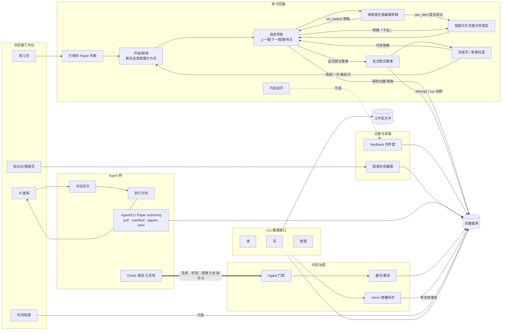

# ACTION-GRAPH — 动作图谱（入口）

2026-10-21 工作区布局收纳：新建课程的内部数据库与构建工件进入 `.lessonkit/`；未迁移课程保持旧路径。新增人类管理动作 `workspace <name> migrate-layout [--apply]`，默认只读预览，显式应用只迁移根目录 `pool/`、`intermediate/` 并更新注册，保留全部历史。L2/L3 同步；不新增学习动作、浏览器按钮或数据库字段。

> **定位**（2026-08-29 所有者定）：借鉴 Archify（代码库→图谱）与 Vivado 分层
> 设计视图的思想，把系统从数据层到工作流层完整登记。**分层明细在
> `docs/action-graph/` 目录**（五层六文件），本页只留总图、铁律与索引。
> 名词归 `GLOSSARY.md` / `PENDING-DEFINITIONS.md`；动作与工作流归本图谱。
> 维护规则见 [action-graph/README.md](action-graph/README.md)——功能变更
> 交付时同步对应层（AGENTS.md 开发纪律 2）。

2026-09-01：图谱关系加入有限确定性消交叉，以及由既有 attraction 驱动的
阴影/管体/高光三层绘制；全部属于浏览器内纯视图。

2026-09-28：浏览器提交作答与自评使用稳定请求 id；响应丢失后原样重试返回首次结果，
不重复写入。详见 L4 的练习工作流与意外分支。

2026-10-16 Agent UI v1 基础（PR135）：右栏增加紧凑页面上下文与自适应输入框，中央页继续优先；新增辅助工作面的折叠动作登记。此阶段 Activity Float、Bottom Dock、Artifact Split 仍是隐藏的展示容器，尚未接入运行状态。

2026-10-18 Agent Activity Float：短时与持续任务统一使用右上角可替换浮层；新增可访问的收起/展开控件，同一轮进度更新保持收起，新轮次重置；切换对话与任务结束时清理瞬态界面。Bottom Dock 退出任务进度呈现。
2026-10-18 Agent 保留导航：同工作区中栏链接与浏览器前进/后退只换中栏，保留右栏现有 DOM、会话、草稿和任务；图谱看板随图谱中栏挂载；更新未来发送上下文；跨工作区与外部导航继续完整页面导航。

2026-10-18 Agent 消息可靠性与工具结果：发送前本地保存消息/上下文/标识，未知接收结果用同一标识核对；已接收失败轮次保留用户消息、真实状态和实际部分回答，显式重试新建关联轮次；工具卡显示实际终态、证据支持的影响及折叠脱敏诊断。见 L0/L2/L3/L4 与 preserve-agent-messages-and-tool-outcomes。

2026-10-20 紧凑 Agent 待发列表与直接中断：输入区一份列表、拖动/键盘重排和既有消息立即发送；Bridge 持久顺序与 ownership 串行交接，不将停止等待混进队列。恢复摘要与真实失败历史分开，审批期间拒绝中断而不隐式排队。见 L0/L2/L3/L4 与 compact-agent-queue-and-direct-interrupt。

2026-10-21 工作台视觉语言 v2：视觉语言由「柔和蒙德里安」重新定义为**暖色 + 现代圆润**（12px 大圆角、饱和三角色色配额、纸面分层不描边、双字体、动效系统）；新增中栏**工作台设置视图**承载外观偏好（主题偏好 / 阅读字面 / 动效偏好 / 声音偏好），由左栏开关打开关闭，偏好按工作区存于浏览器 `localStorage`，不写池。知识图谱页完全不在范围内；请求与持久化不变。见 L3 与 workbench-visual-language-v2。

2026-10-22 图谱节点视觉语言（graph-node-visual-language）：知识图谱页的**节点外观**重做——同心圆节点形态、屏幕空间尺寸、图谱自有暖色板、四个投影各自的图谱色键、随投影切换的图例、标签重叠让位、夜纸值集。**不新增任何用户动作**：既有搜索 / 投影切换 / 状态筛选 / 聚拢 / 聚焦 / 缩放 / 布局种子全部照旧，交互、布局物理、关系线、后端与持久化不动；请求序列与学习事实不变。见 L3 与 graph-node-visual-language。

2026-10-22 工作台视觉语言 v2 落地（workbench-visual-language-v2）：**工作台设置视图已实现**（路由 `/w/{name}/settings`，左栏「外观设置」入口开关，关闭后中栏回到打开前的视图，Agent 右栏不重建）；四项外观偏好（主题 / 阅读字面 / 动效 / 声音）**按工作区存于浏览器 `localStorage`、跨工作区独立、换工作区要重设外观**，不写池。**新增动作**：切换主题（暖纸 / 夜纸，走台灯转场）、连对升级反馈（计数器 / 火苗簇 / 参数化横幅 / 断裂负反馈，纯呈现零写入）。**退役**：跨页练习范围托盘（死代码归零，产品行为零变化）。**改级**：阅读内容的挂载名由 `.rich-text` 改级为 `.wb-reading`（**改级已完成**：`.rich-text` 剩下的 36 条死 CSS 规则已在 2026-10-22 的别名期收尾时删掉，`workbench/` 下 `.rich-text` 现在只剩三行说明性注释、选择器命中 0）。请求序列、持久化与学习事实不变；知识图谱相关动作零改动。见 L3 与 workbench-visual-language-v2。

## 铁律（所有者钦定）

2026-10-17：既有 `migrate-progress.py` 的 schema ensure 修复 attempt 临时父表外键，
保留记录并报告剩余缺失父记录；无新增 CLI/API 或用户动作。结构修复与历史证据恢复分开验收。

1. **严禁显式命令面板**——动作触发只走对话内自然语言→结构化动作；CLI 是
   外部 Agent 通道，不主动扩张界面。
2. **动作结果呈现分型**：独立于现有功能的（报告/视图）→ 对话框内；融入现有
   功能的（Agent 填目标/计划字段）→ 版面原位直接变化。
3. **Agent 池权限**：知识点池与全部题目池 Agent 可经 CLI 增删改查；门禁是
   决断辅助，不是权限闸门。
4. **标签一律完整显示**，不截断、不省略号。

## 分层索引

| 层 | 文件 | 内容 |
|---|---|---|
| 总纲 | [action-graph/README.md](action-graph/README.md) | 分层模型、铁律、状态标记、队列 |
| L0 数据层 | [action-graph/L0-data.md](action-graph/L0-data.md) | 表/文件/会话键：谁读谁写 |
| L1 服务层 | [action-graph/L1-services.md](action-graph/L1-services.md) | 域逻辑模块与依赖 |
| L2 接口层 | [action-graph/L2-interfaces.md](action-graph/L2-interfaces.md) | API 62 路由 + CLI 24 命令 |
| L3 动作层 | [action-graph/L3-actions.md](action-graph/L3-actions.md) | 动作登记（入口/权限/读写/状态）+ 留痕 |
| L4 工作流层 | [action-graph/L4-workflows.md](action-graph/L4-workflows.md) | 十条主流程 + 意外分支总清单 + 同步记录 |

## 总图

普通 Paper 由浏览器从已保存列表开始或继续；浏览器不提供学习者手工选题与组卷。Agent/CLI authoring 保留。
导航、到达最后一题和暂停都不提交；普通 Paper 只在明确交卷后完成，自评可跳过。旧记录与闪卡继续走既有兼容语义。

## 队列（2026-08-29 问卷后所有者确认）

① 本图谱 v2（完成）→ ② 讲解/诊断彻底移除（完成，remove-explain-diagnose）→
③ 目标补齐（完成，complete-goals-loop）→
④ Check 管线（完成，introduce-check-pipeline）：定名 Check、批次 id+
整批回滚、桥 check_ingest 动作、candidate_problems 退役。

## 变更留痕

- 2026-10-22 工作台视觉语言 v2 落地（workbench-visual-language-v2）：**新增动作**两条——
  「切换主题（暖纸 / 夜纸，走台灯转场）」与「连对升级反馈（三级计数器 + 火苗簇 + 一份
  参数化横幅 + 断裂负反馈，纯呈现、零写入零请求）」；**改状态**两条——第七节「打开 / 关闭
  工作台设置视图」「修改外观偏好」由「已定义未实现」改为「**已实现**」（路由
  `/w/{name}/settings`；偏好写 `wb_settings_<工作区>`，**按工作区、跨工作区独立、
  换工作区要重设外观**，不写池、不产生学习记录）；**退役**一条——「跨页练习范围托盘」
  （128px 死预留 + `.scope-tray-*` 死 CSS + 两处 JS 空壳引用已归零，**产品行为零变化**：
  托盘从未被渲染）；**改级**一条——「渲染阅读内容」的挂载名由 `.rich-text` 改级为
  `.wb-reading`（**已彻底退役**：HTML 挂载点早已归零，2026-10-22 的别名期收尾把剩下的
  36 条死 CSS 规则也删掉了 —— 并列选择器只去掉 `.rich-text` 那半、保留 `.wb-reading`
  那半且取值逐项未动 ⇒ `workbench/` 下 `.rich-text` 现在只剩三行说明性注释、
  **选择器命中 0**）。请求序列、持久化与
  学习事实不变；知识图谱相关动作零改动。视觉层仍待落地的部分（结构已就位、样式规则未跟上）
  登记在 `docs/PRODUCT-MANUAL.md` §10.1，不在本图谱记为动作。按 `action-graph/README.md`
  的维护规则，改级/退役动作应同步 L4 受影响的工作流图——L4 不在本波范围，留给下一波。
  （→ **2026-10-22 已同步 L4**，见 `action-graph/L4-workflows.md` 末尾「L4 同步记录」：本波四条里
  只有「连对升级反馈」在 L4 有落点（并入 W1，不另起工作流）；「切换主题」是横切外观偏好、
  「跨页练习范围托盘」从未被渲染、「渲染阅读内容」改的是 CSS 挂载名——这三条**在 L4 无对应工作流**，
  L4 图零改动。）
  见 L3 与 workbench-visual-language-v2。
- 2026-10-22 图谱节点视觉语言（graph-node-visual-language）：知识图谱页的节点外观重做（同心圆节点、屏幕空间尺寸、图谱暖色板、四个投影各自的图谱色键、随投影切换的图例、标签重叠让位、夜纸值集）。**本图谱的动作不新增、不退役、不改级**，图谱相关动作条目零改动——既有搜索 / 投影切换 / 状态筛选 / 聚拢 / 聚焦 / 缩放 / 本地布局种子的入口、权限与读写面全部照旧，本次只改呈现。
  **登记一处表述冲突（不改动作条目）**：L3 第二节「图谱关系绘制与 viewport/label LOD」一条里的 **label LOD** 措辞，指的是按缩放阈值隐藏标签；本次之后标签可见性的判据改为**重叠让位 + 可见标签预算**，缩放不再决定标签是否出现。该动作的入口、权限、读写面与状态均未变，因此**不改动作条目**，只在此登记，留给实现阶段以规格为准。L3 铁律 4「标签一律完整显示，不截断、不省略号」与新规则一致，无需调整。请求序列、持久化与学习事实不变。
- 2026-10-21 工作台视觉语言 v2（workbench-visual-language-v2）：视觉语言由「柔和蒙德里安」
  重新定义为**暖色 + 现代圆润**；新增中栏**工作台设置视图**（左栏「设置」区开关打开关闭），
  承载主题偏好 / 阅读字面 / 动效偏好 / 声音偏好，偏好按工作区存于浏览器 `localStorage`，
  不写池。新增动作「打开/关闭工作台设置视图」与「修改外观偏好」，均**已定义未实现**。
  请求序列、持久化与学习事实不变；知识图谱相关动作零改动；口径类动作（正确率、
  完成练习次数）不在本轮。见 L3、GLOSSARY、PRODUCT-MANUAL、ARCHITECTURE。
  （→ **2026-10-22 已落地**，两条改判为「已实现」，见本节同日条目。）
- 2026-10-19 Paper 自由导航与 Agent/CLI authoring 边界（free-navigation-paper-practice、remove-learner-manual-paper-selection）：普通 Paper 增加 `per_item` / `on_submit` 答案展示方式、全卷自由导航、逐题提交与显式交卷、完成页答卷往返及独立重练轮次；只有显式交卷归档，普通 Paper 自评可跳过。学习者练习页只管理既有 Paper，不再手工选题或调整成员/顺序；Agent/CLI 的 pull、筛选、精确题号与保存 authoring 保留。章透镜、图谱筛选与节点聚焦仍是阅读功能；闪卡和旧轮次语义保留。见 L0–L4。
- 2026-10-16 Agent 工件交付（agent-ui-v1-implementation，PR129/135/136/137）：Agent 只能按已保存 Paper 记录产出 `paper_artifact` 工件卡（标题/题数取自记录，丢布模型 URL）；最新工件可临时展开 Adaptive Split 预览，历史工件卡不自动展开，打开组卷页始终是显式操作。
- 2026-10-13 作者内容镜像字段扩展（expand-content-mirror-fields/PR123）：既有 `mirror`
  读写动作增加通过现有路径校验的逻辑图像引用和经难度 authority 校验的完整题目评级组；旧
  schema 不迁移列，旧投影只按下一修订升级。L0/L1/L3 更新既有读写责任，无新增 CLI 动作、图像
  字节传输或学习记录写入。
- 2026-10-13 图谱关系渲染（graph-webgl-rendering）：既有关系显示使用唯一 WebGL2 绘制路径；渲染无法启动时以可读状态终止本次图谱运行，不回退 SVG、不新增数据写入或用户动作。L3 既有图谱关系责任同步。
- 2026-10-13 图谱 viewport/label LOD 与本地布局种子（graph-lod-layout-seeds）：仅更新现有图谱读取责任；viewport culling 不改变图成员或选择，完整拓扑命中直接采用缓存坐标并停止求解，部分命中只在首帧作为临时锚点，释放后由同一 Worker 继续求解。无新增用户动作、Pool 写入或 SQLite 字段；L3 现有图谱绘制责任同步。
- 2026-10-12/17 普通题结果回看（practice-review、revisit-paper-answers-and-edit-self-rating）：旧行为是在没有服务端执行身份时回看紧邻上一题，并在 Paper 同轮回看已有作答或「不会」普通题时每次收起参考答案；游标与当前草稿独立，Agent 焦点跟随可见题。此回看/收起规则已由 2026-10-19 普通 Paper 全卷自由导航与答案展示方式覆盖，当前行为见 W1。修改已有自评只覆盖确切 Attempt 关联评分/评语，不新增记录或重放学习影响。闪卡仍沿用上一张/下一张游标导航。见 L3 动作登记。
- 2026-10-12 学习证据查询（agent-learning-evidence）：新增只读 CLI `evidence`，按知识点
  返回最多 20 条近期作答及当前题面/实际记录结果；缺库时拒绝连接且不建文件。L0/L1/L2/L3
  登记既有表读取者、查询服务、命令与只读动作；L4 在需要历史依据的 Agent 对话中登记按需读取。
- 2026-10-12 练习页 Agent 上下文（agent-context）：保留可解析正式题作为页面锚点，仅从同一 active practice 附最多四道前序已结算正式题；明确上一题/近期指代才改变轮次焦点，否定或竞争目标保留页面默认，未知题号与闪卡号不成为题目焦点。构建上下文只读、不移动游标、不写学习记录。见 L1/L2/L3/W4。
- 2026-10-09 正文排版检出（implement-kp-text-typesetting-check）：既有内容清单
  有效检查/成功 apply 与 pool validator 报告新增同口径的 `typesetting` 结果，
  Bridge 动作结果保留它；纯检查不新增写入动作、门禁、CLI 选项或退出码。
  只度量正文并只报事实；pipeline 只读调用是 kp-text-typesetting-check 已授权的
  窄例外。章节结构识别、其他字段区间与正文修复仍是原 change 的延期/范围外事项。

- 2026-08-29 建图（v1：总图+六域登记表）；同日讲解/诊断标待退役。
- 2026-08-29 v2 分层重构：明细迁入 `docs/action-graph/` 五层六文件；新增权限列
  （问卷 B1）、意外分支层（L4，回应所有者"不许想当然"要求）、铁律四条、队列四项。
- 2026-08-29 目标生命周期与助填动作落地（complete-goals-loop，队列③）：goals CLI 上线。
- 2026-08-29 讲解/诊断移除落地（队列②）：任务机退役，对话桥保留，各层同步。
- 2026-08-29 Check 管线落地（introduce-check-pipeline，队列④）：定名 Check（专题 22）；
  三配方 apply 记批次 id+行戳记+manifest 快照+ingest_batches 登记；
  `ingest rollback --batch`、桥 `check_ingest` 动作、结果卡回滚按钮、
  `POST /ingest/rollback` 上线；candidate_problems 读路径退役（pull/mastery/hub
  停读，表与 data candidate 子命令标**待退役**）；L1/L2/L3/L4 同步。
- 2026-08-31 目标时间跑道落地（goal-calendar-lanes）：目标可带开始日期，月历按周续接并为重叠目标分轨；时间视图继续只读。
- 2026-08-31 Agent 执行计划上线（render-agent-execution-plan）：Bridge 将提供方
  活动归一为可读步骤，对话流同行更新并恢复成功轮次记录；L3 同步。
- 2026-09-01 图谱指标投影动画落地：切换指标保留节点身份，以内存目标位置与半径连续过渡；不写学习数据。
- 2026-09-01 图谱多状态筛选分群落地：按状态并集收束可见子图并分团聚拢；只读、内存态。
- 2026-09-01 任务量趋势线落地（add-workload-trend-curve）：时间安排在准确的
  14 日柱值上叠加只读平滑趋势，重日红点提示；无新写动作与接口。
- 2026-09-02 时间安排 A 方案落地（refine-time-view-a）：月历改为轻网格、细轨道
  与单次标题；14 日视图改为准确柱值、总量 / 峰值 / 逾期摘要与固定日期轴，
  并移除容易误读的平滑线；重日预填动作和数据接口不变。
- 2026-09-01 闪卡方向能力落地（enable-flash-card-directions）：Check 可声明单向/
  双向，拉取按内容能力展开并复用既有方向调度键；旧卡与旧调用默认 forward。
- 2026-09-01 闪卡方向 UI 落地（render-directional-flash-cards）：显式闪卡模式内可选
  混合/正向/反向并以 ⇄ 交换；单向下展、双向扇形揭示，评分写最终使用方向。
- 2026-09-20 init 简化与中文名路由修复（init-ergonomics-and-cjk-names）：
  `init` 的 `path` 可省（默认当前目录），course 按「显式 `--course` › 已有池名 ›
  ASCII 文件夹名」推导；四条带名路径
  （页面 / API / 附图 / 图谱工件）统一对 URL 编码段解码，API 分派把未知名收成
  404；`registry._find_pool` 提为公开 `find_pool`。L2 同步。
- 2026-09-21 课程标识符与人名的分离（course-identifier-and-name）：文件夹名
  无法给出 ASCII 缩写时不再报错——自动分配顺序短码 `c01`/`c02`…（扫注册表与
  本文件夹 `pool/*.db` 取最大号 +1），显式 `--course`/`use` 一律校验为小写
  ASCII 标识（拒绝理由写进报错）；顶栏只显示工作区名与章，机器标识不再露面。
  L2、PRODUCT-MANUAL、GLOSSARY 同步。
- 2026-09-21 单一命令名（single-cli-name）：`wb` 入口退役，本项目只留
  `lesson-kit`（模块形式 `python -m workbench.cli.main` 等价，prog 同名）；live
  文档与三条规格同步改名，历史档案不动；`Scripts/wb.exe` 归还 Weights & Biases
  （重装用 `"wandb==0.25.1"` 钉版本，裸 `--force-reinstall --no-deps` 会升版本且缺依赖）。
- 2026-09-21 工作区文件隔离（workspace-file-isolation）：把"一个工作区只碰自己
  文件夹、一个工作区只装一门课"落成硬校验——会话/轮次 id 必须是 `conv-NNN`/
  `turn-NNN`（原先 `%2F` 段可穿越到别的工作区并 `rmtree`）；不带名命令在多个
  工作区注册时拒绝猜（报错给出位置名可粘贴命令）；注册校验池在工作区内、路径与
  池不重复、同名冲突不静默覆盖；池候选排除 ingest 备份，同一文件夹多份池且无
  `--course` 匹配时拒绝并列出（本仓库 `pool/` 的 pre-readiness 副本因此不再被
  当成主库）；章与课程同规则校验；入池门禁把 id 钉在本工作区课程前缀上、
  figure-patch 的课程/章与最终路径必须落在本工作区 `.lessonkit/figures/` 内；
  会话提示词示例改用上下文里的真实课程/章（原先硬编码 `dmath-ch06`）。
  L1/L2/L3、GLOSSARY、PRODUCT-MANUAL 同步。
- 2026-09-21 dashboard 章透镜（dashboard-chapter-filter）：顶栏工作区名旁新增
  「章」单选开关（关 = 全课程），与 `lesson-kit use` 写同一个注册表值；章名单
  从池内容 id 派生（`Pool.chapters()`，不建表）；前缀计算收敛到
  `Pool.scope_prefix()`（空章 = 课程前缀 = 全课程，从巧合升为契约）；hub 卡片
  四项统计统一为整课程口径（原 kps 按章、题数/待复习全池）；服务端新增写当前章
  端点 `POST /api/w/{name}/chapter`；页头/标题按透镜显示「当前章节」或
  「全课程」；透镜只作用于"看"，选区跨章且切换不丢。L2/L3、GLOSSARY、
  PRODUCT-MANUAL 同步。
- 2026-09-21 难度可选门控（optional-problem-difficulty-gate）：`problems` 增列
  `difficulty`（可空 1-5；`knowledge_points.difficulty` 原样），三条入池通道
  （微测 patch / 正式题 apply / KP content-patch）改为**可选**语义——填了必须
  int 1-5 且同 item 带非空 `difficulty_basis`，缺依据拒收整批、不填放行、依据
  不落盘；KP 门禁的必填集合移出 difficulty（legacy 提取路径的默认 2 按分层
  铁律不动）。Un-migrated 旧池：不声明难度照常可用，声明了则拒收并给出
  `pool/scripts/migrate-progress.py` 命令。生成侧提示词要求逐项给出难度 + 依据、
  不确定可弃权；`difficulty_mix` 误名改为 `problem_type_mix`（题型直方图）。
  无消费者、不回填旧题、学习者可见面零变更。L1/L3、GLOSSARY、
  PENDING-DEFINITIONS（真题拟合数据前奏）同步。
- 2026-09-22 题目来源与惰性四维难度（problem-difficulty-and-provenance）：上一条
  单值门控被本条取代。题目新增 `origin_kind`，与材料 `source_kind` 正交；派生
  `ai_generated/exam/textbook/other` 互斥组供 CLI/API 筛选。正式题与微题的客观难度
  改为知识跨度、推理深度、迁移距离、构造开放性四维 1–5，`cognitive-v1-equal-mean`
  生成一位小数总分；全组可空，创建和入池不触发评级。公开动作是
  `lesson-kit difficulty <workspace> check|apply --input <file|->`；check 零写入，apply
  整批原子覆盖。题干、解析、知识点关联或题型变化清空评级。pull 可显式按来源、总分、
  分维与 balanced 策略筛选；未传新参数保持旧顺序，学生 UI 不展示难度。
- 2026-09-22 Pi 活动消息流（pi-activity-message-stream）：复用既有 350ms polling 与
  normalized activity。Pi 的读/写/搜索/命令/Lesson Kit 操作显示为独立消息并按 id
  原位更新，具体活动切开前后文本气泡；输出默认折叠且落事件前遮盖/截断。通用阶段、
  hidden reasoning 和原始协议不显示；Codex/Claude 的执行计划不变。
- 2026-09-23 首次真实使用修缮（first-use-conversation-content-fidelity）：新增  `content-bundle` 原子内容批次（知识点/正式题/微题/闪卡/必需原图，key 互引、服务端分配 id、
  大清单暂存本对话 jobs、整批预检与单备份、缺图零写入、回滚只删无引用图片）；删除浏览器
  关键词意图门，合法纯新增自动执行；题目新增来源证据/来源答案/解析来源三列并在两个渲染面
  显示；浏览器与服务端富文本统一支持 GFM 表格；Pi 改为每对话一个隐藏 `--mode rpc` 常驻
  进程（空闲 30 分钟回收、abort 优先、接受后崩溃不重放），全部 provider 子进程 Windows
  无窗口。L1/L3 同步。
- 2026-09-24 Agent 代录与更正尝试（agent-assisted-practice-records）：新增 `lesson-kit
  attempts`（`list`/`get` 只读、`check` 零写入预检、`apply` 一份清单多题单事务、`correct`
  按 attempt-id 整体替换）与 `attempts sources` 答卷目录登记；池新增 `attempt_operations`
  留痕表与 `feedback_events.attempt_id` 列（增量迁移、旧行不动）；带评分的尝试复用既有
  1–5 四件套并只结算一次，无评分的尝试只留文本、不碰任何投影；同 `request_id` 同内容重发
  回放首次结果，异内容零写入拒绝；更正先比投影快照、有更晚活动或更晚尝试即零写入拒绝，
  否则恢复前快照→替换尝试→按新评分重算→更新快照；练习页发消息改为附带**聚焦草稿**
  （未提交作答/选项/备注/当前可见图片，服务端限长、零写入），普通对话与只读图片不产生
  任何学习记录；图片只按目录被 Agent 读取，不入池、不建索引。L0/L1/L2/L3/L4、GLOSSARY、
  PRODUCT-MANUAL 同步。
- 2026-09-25 组练习与接口归属（practice-set-export-and-cli-audit）：`lesson-kit pull` 升级为
  **组一次练习的唯一入口**——范围/单题/条件筛选（新增 `--exam-year`）/薄弱·到期·错题三种
  驱动可组合，每题回报入卷理由；默认输出**完整题目行**（与 `/pull` 对齐，`--ids` 保留旧形状），
  补上规格早已要求却无 CLI 入口的 `--include`；`--plan` 落练习清单（输入清单，不是学习记录）、
  `--print` 出学生卷+解答卷（题号对齐、缺解「待补」、无答案与内部标识）、`--check` 零写入预检。
  池新增可空 `problems.exam_year`（纯增量、不回填、前缀匹配筛选；未迁移池只在用到时报
  migrate 命令）。新增 `workbench/surface.py` 接口归属表 + 对账测试，把「谁该有 CLI」变成
  机器事实（修正 L2 的 31/20 → 32/22）。同批修四道既有裂缝：`practice` CLI 与页面同事务同
  校验、`feedback` CLI 补闪卡与方向、`goals` CLI 写入后失效计划缓存、`weak`/`due`/`ls`
  提供 `--json`；删除两处死面（`ingest render` 的无用 target、`ingest gate/apply` 收了又拒的
  entity 取值）。L0/L1/L2/L3/L4、GLOSSARY、PRODUCT-MANUAL、REQUIREMENTS 同步。
- 2026-09-25 跨章内容批次（cross-chapter-content-bundles）：**一份清单可以跨章**——每个知识点/
  题目/闪卡可写自己的 `chapter`（缺省用清单顶层章；两者都缺失即点名拒收，不回退当前章；与当前 ai-teacher-bridge spec 和 FILE_CONTRACT.md 一致），发号、图片目录、
  微题 id、重复检查全部跟随该项的章，显式 id 必须与该项章同名（原先 ch14 的 id 塞进 ch12 清单
  会把图落错目录）；一次预检、一份备份、一个事务不变，但**按章各记一个批次**，因此
  `ingest rollback`/结果卡可**只撤其中一章**（回滚本就按批次删行+删无引用图片，无章的假设）；
  结果带 `batches`（单章时仍保留旧的 `batch_id`/`counts`），结果卡每章一行、各带回滚按钮。
  一轮回复里的**每个** content-bundle 区块都会被依次应用（原先只应用第一个、其余静默丢弃），
  所以「12–14 章都导进来」一次回答即可；提示词写明清单可跨章、按章成批、遇多区块继续。
  顺手修：回滚改写 `related_kp_ids` 前先查列（老池缺列不再报错）。L0/L1/L2/L3/L4、GLOSSARY、
  PRODUCT-MANUAL、REQUIREMENTS 同步。
- 2026-10-06 搜索与来源维度升级（problem-search-and-origin-filter；历史记录：练习页浮窗搜索选题已于 2026-10-16 随 PR130 退役）：**一个搜索框变成两个关键词
  域**——`GET /search/problems` 收 `stem` 与 `source`（旧 `q` 删除，不映射、不兼容），题干域
  = 标题+题面，来源域 = 来源证据+考查年份+题面开头的 `【…】` 标签段（老池把卷面
  身份只写在那里的事实）；每域按空格切多词、域内 AND、跨域 AND，两参数都空返回空集而非全池。
  两个域的定义只有一份（`domain.facets.stem_text`/`source_text`），搜索与选题都读它。
  **`origin_kind` 单值升为多值维度**：进 `/pull-facets` 第四维（浮窗显示历年原题/改编/AI生成）、
  `pull.select(origin_kinds=…)` 任一命中、CLI 改可重复的 `--origin-kinds`，`POST /pull` 收
  `filters.origin_kinds` 与顶层 `origin_kinds`。`lesson-kit pull` 新增 `--search-stem`/
  `--search-source`，`data search` 查询改多词 AND。浮窗保存键升为
  `wb_practice_filters_v2_<ws>`（旧键不读不迁移）。零兼容：删掉的三处旧形都是无法表达新
  语义或一次点击即可重建的状态。L2/L3/L4、GLOSSARY、PRODUCT-MANUAL、REQUIREMENTS 同步。
- 2026-10-06/07 组卷页浏览与折叠（practice-set-item-preview）：已保存试卷的卡片默认收起，
  当前标签页按工作区记住展开状态；卡片命令不改变展开状态，错误状态留在折叠区外。题目项可
  就地展开预览题面与来源，不含答案、不改变试卷数据。L3 与 PRODUCT-MANUAL 同步。
- 2026-10-10 恢复 PR106 题目标签删除（restore-pr106-problem-label-removal）：schema ensure
  物理删除 `problems.topic_label`，旧表重建不再保留该列；取代 PR111 的列保留语义。
  闪卡标签与其他内容/学习记录不变，外部备份承担历史恢复；不新增或改级 CLI/API 动作。
- 2026-10-10 作者内容镜像 v1（json-content-repository-sync，PR110）：本地 JSON 作者内容
  投影与 `lesson-kit mirror init/check/status/sync` 上线（CLI 顶层命令增至 24）；L0 登记
  两张台账表，L1 登记内容镜像模块，L3 第三节新增三条动作，L4 新增 W9 与四条意外分支。
  引导期加固：不可读仓库文件进入 init 报告并阻断被其点名实体的建档、逐实体写失败不再中断
  整轮、缺失文件恢复在台账失败后可重试。不执行 Git 网络操作，不因仓库缺文件或删除请求删池内容。
- 2026-10-12/13 图像文件投影修复（versioned-figure-assets，PR113）：新增 `mirror figures` 的
  工作区/checkout 根目录锚定、派生归属索引预检与旧 64-hex 内容身份保护；L0 登记 checkout
  二进制文件和索引，L1/L2/L3 登记 Data 模块与 CLI 动作，L4 增加 W10；GLOSSARY、
  FILE_CONTRACT、ARCHITECTURE、PRODUCT-MANUAL 与 OpenSpec change delta 同步。
- 2026-10-14 Agent 保存试卷：新增 `lesson-kit papers <workspace> save --input <manifest>`；校验已导出的练习清单并委托给现有试卷写入器。`pull --plan`/`--print` 仍表示导出，只有成功的 JSON 回执才能确认试卷已加入组卷页列表。L2/L3/L4、FILE_CONTRACT、DATA_MODEL、PRODUCT-MANUAL 同步；L3 登记 Agent 保存练习集动作，W6 明确“练习清单导出 → CLI 保存为试卷 → 成功回执 → 组卷页列表”；`pull --print` 仍仅生成打印稿。
- 2026-10-17 Paper 独立进度：切卷改为暂停/恢复，不归档放弃；新增草稿保存、原卷影响预览确认和 CLI list/get/preview/update/delete。手工结构修改只清该卷未完成状态；修题只重置受影响题；删题保留其他进度及历史身份。删卷不删题。退役重复「AI 生成解析」独立展示，保留正常解析与来源字段。同步 L0/L2/L3/L4 与职责文档。
- 2026-10-17 Paper 执行状态对齐（align-paper-execution-status）：保存卷列表、当前练习、开始和暂停共用执行续练校验；题目身份/顺序、版本、可用性或清单校验不匹配时说明原因，不把旧进度显示成当前试卷进度。当前卷不能暂停时，其他卷的开始状态显示阻塞原因并保留其自身进度。有效的改名、导出和删除仍可单独执行；不新增、退役或改级动作。
- 2026-10-18 Agent 消息队列与中断后发送（queue-agent-messages-and-interrupt）：运行中接受 FIFO 消息或显式中断；中断等待捕获轮次终态和 worker 清理，优先消息结束后旧队列仍暂停。待处理消息可编辑/移除并显式继续。L0/L2/L3/L4、FILE_CONTRACT、ARCHITECTURE 与 PRODUCT-MANUAL 同步；无 Pool 字段。
- 2026-10-18 Agent 既有 Paper 更新确认（complete-agent-message-lifecycle）：Agent 只提议成员/顺序变化；页面展示精确进度/草稿影响，用户批准后复用现有 writer。过期快照零写入并刷新影响；待确认期间 composer 可用但队列暂停，取消或批准后仍需手动继续。见 L3/L4 与 PRODUCT-MANUAL。
