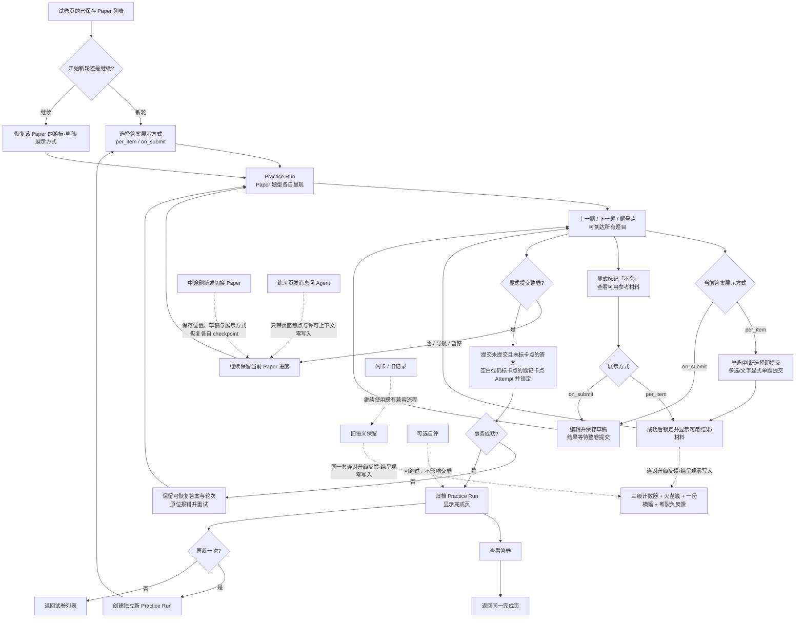
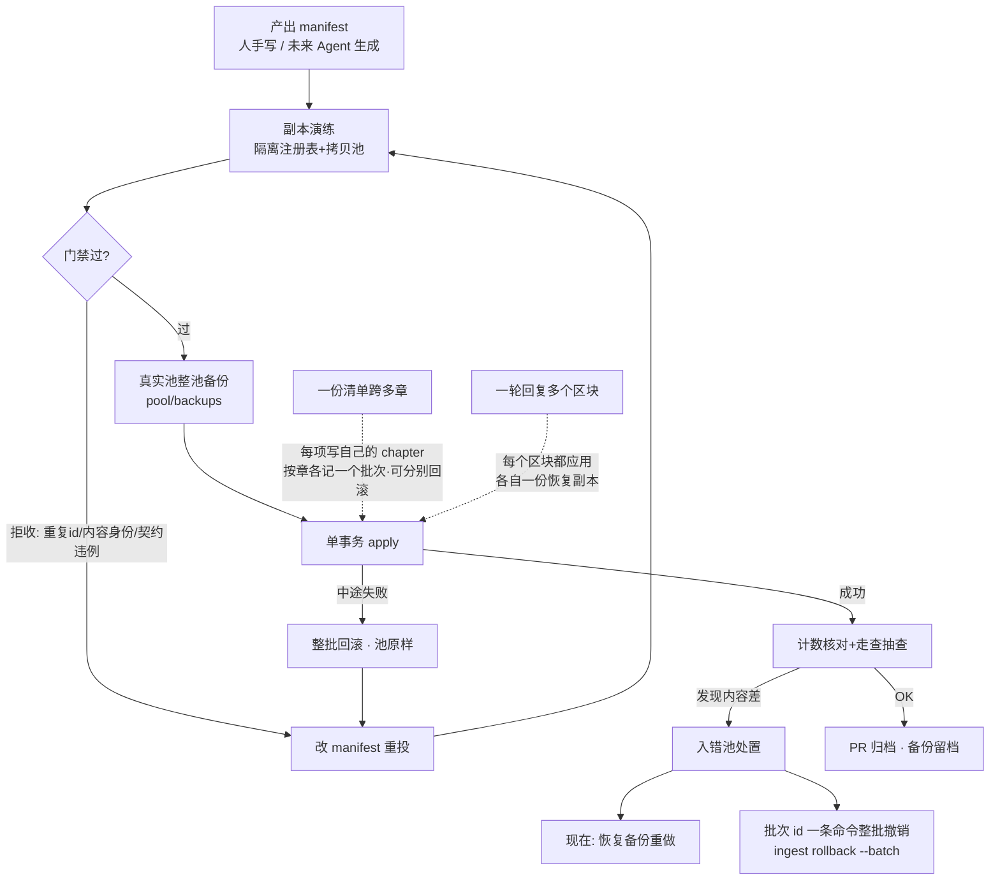
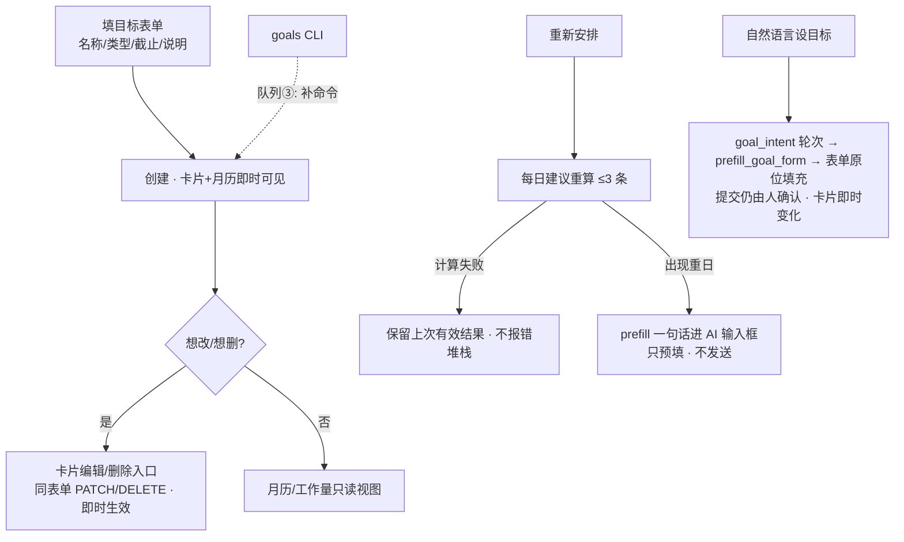
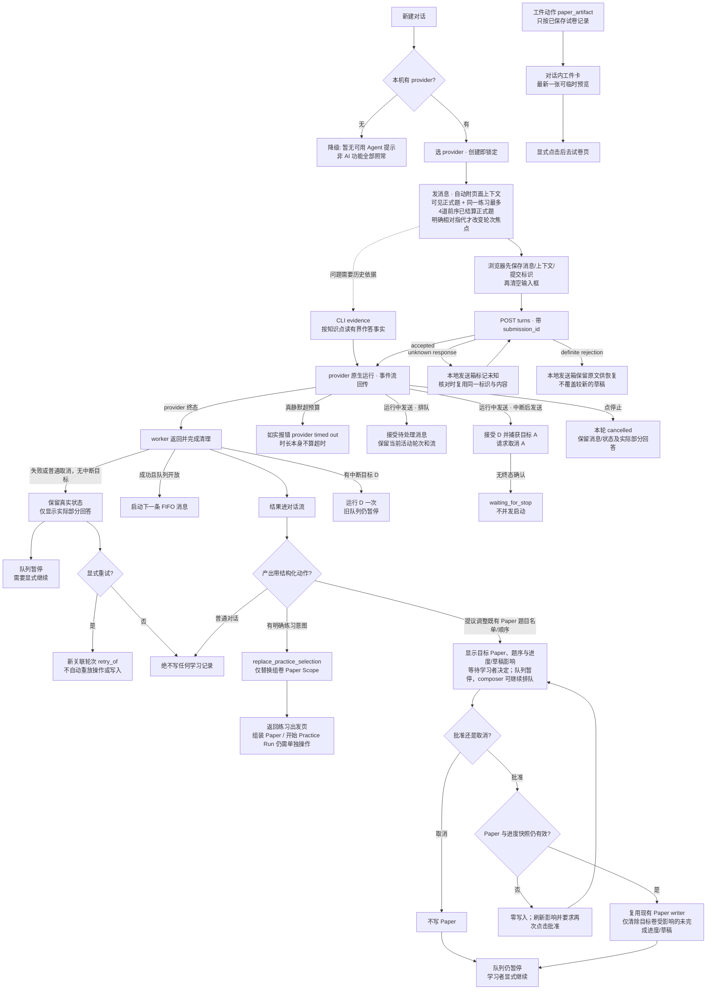
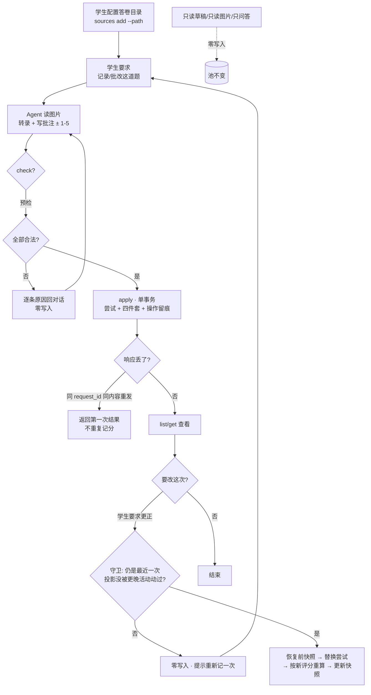
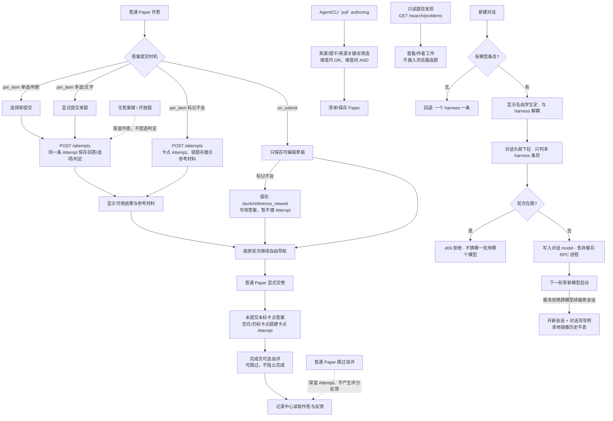
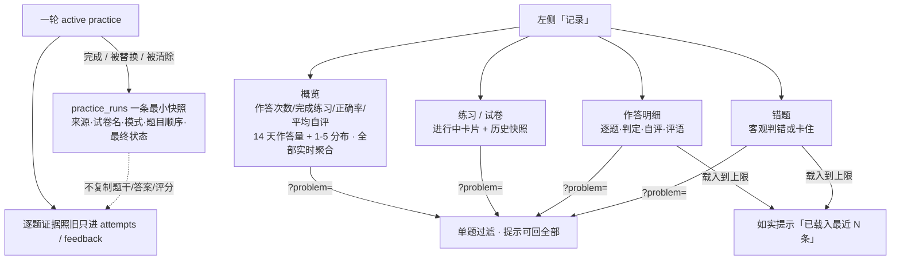
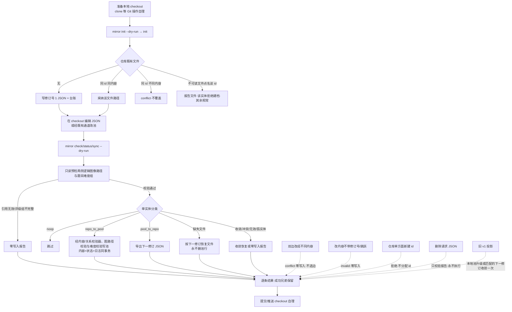
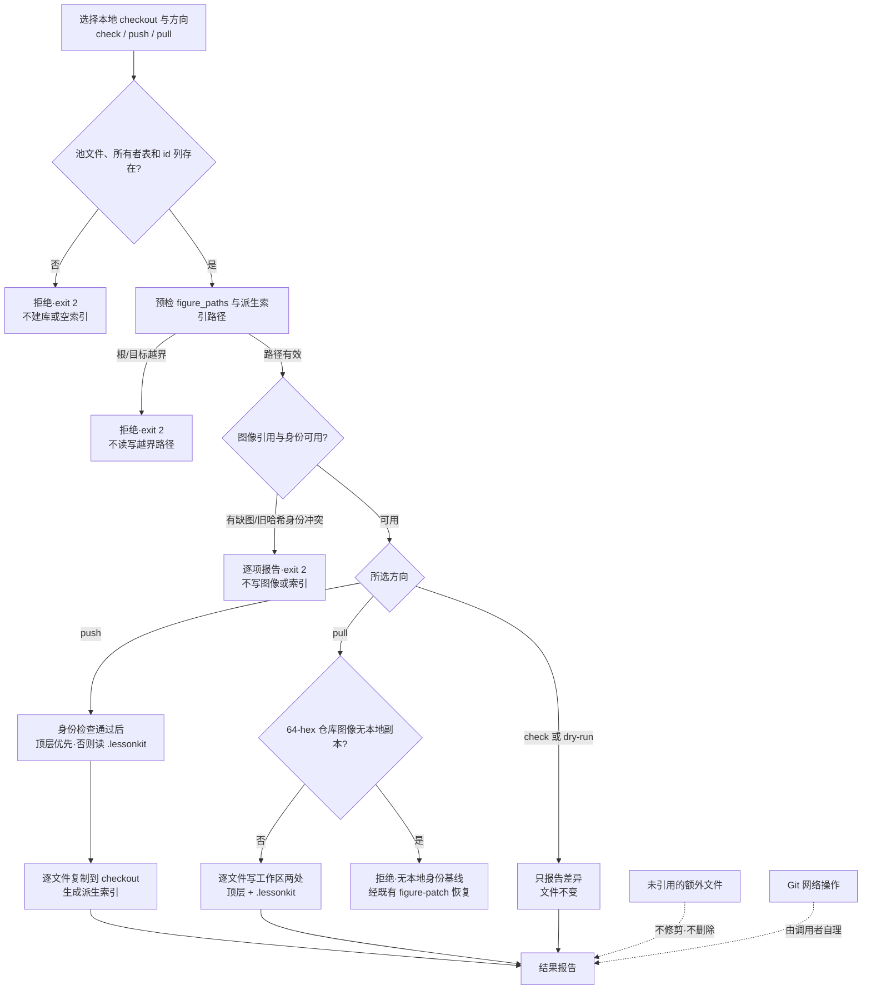

# L4 · 工作流层（用户真实路径 + 全部意外分支）

> 本层是 v2 的灵魂：**不许只画 happy path**。用户会回退、放弃、跳过、直接关闭——
> 每个出口都要有分支和落点。每条边可回溯 L3 动作；每个写库节点可回溯 L0。

## W1 · Paper → Practice Run 练习回路



核心不变量：**浏览器从既有 Paper 开始或继续；自由导航只保存位置与草稿；普通 Paper 只在明确交卷成功后完成。**到最后一题、暂停、切卷或返回答卷都不会代替交卷。`per_item` 的单选/判断选择自动提交，多选/文字需显式提交；成功后锁定。`on_submit` 在整卷交卷前保留可编辑草稿。任一模式显式标记「不会」都会揭示可用参考材料；`per_item` 立即写卡点 Attempt 并锁题，`on_submit` 只保存可编辑标记，改答可清除卡点标记但保留看过参考材料的事实。交卷将未提交且未标卡点的答案作为作答，其余空白或仍标卡点的题写为卡点 Attempt 并锁定；完成后可读答卷并返回完成页，重练会新建独立轮次。普通 Paper 自评可以跳过；旧记录和闪卡沿用旧语义。

> 2026-10-22（workbench-visual-language-v2）：**连对升级反馈**（三级计数器 + 火苗簇 + 一份参数化横幅 +
> 断裂负反馈）登记在 L3 第一节，落地形态是**练习页内的一段被动呈现**——**两条练习流都挂了**：
> 试卷流的逐题提交（`paper-practice.js`）与兼容流程的练习题呈现（`practice-flow.js` 的 `#stream` 区，
> 在 `#legacy-practice` 内），**纯呈现、零写入零请求**，不改变任何路径与落点 ⇒ **不另起一条工作流**，
> 只在 W1 上留痕。裁决见 `decisions.md` **A-54**（复用同一套 ticker / 火苗 / 横幅，不得另造一套）。
> ⚠️ 它的**三档配色与火苗形状**的样式已在 2026-10-22 晚间补齐 ⇒ 现在**看得见**了。
> ⚠️ 另一条边界：**只有「有逐题判定」的模式里出现**——`on_submit` 模式不挂连对计数器
> （裁决 A-59；该条**实现尚未跟上**，登记在 `docs/PRODUCT-MANUAL.md` §10.1.1）。

## W2 · 内容入库（唯一合法写池通道）



> 2026-09-25（in-place-problem-edits）：入库之后改题不再等于「删除重导」。原地补丁保留题号与全部学习记录，可把选项从题面拆进 `options` 让旧单选题变成小测题，整批存旧值可 `rollback` 还原；判断题/单选题的题干上限同时从 200 放宽到 800 字。批量修改只在学生明确要求时执行。
> 2026-09-26：题干上限取消（真题长篇客观题不再被退回综合题），摄入门禁与原地改题同步生效。

> 2026-09-25（ingest-mode-choice-and-contract-parity）：入库时可选题型——判断题（`quiz_type: yes_no`）
> 与单选题（`single_choice`/`multiple_choice` + 选项）即使**题源没有答案键**也能入库：这类题不判分，
> 练习页写明「本题未录入答案键」，作答后可选择自评，答案键可事后用 `data update problem` 补；普通题目（不给
> `quiz_type`）进综合题，声明小测/判断模式却不给 `quiz_type` 会被拒收。学生一次说清的章要一轮导完，
> 前一章入完不再问「要不要继续」；章推不出来（该项与清单顶层都没有 `chapter`）时点名拒收，不再
> 静默按当前章落库。

> 2026-09-25（cross-chapter-content-bundles）：清单可跨章（每项声明自己的 `chapter`，缺省顶层→当前章），
> 发号/落图按该项的章，题目身份重复检查覆盖整个课程；按章各记一个批次，因此回滚可以只撤其中一章；一轮回复里的每个
> content-bundle 区块都会被依次应用（各自一份恢复副本），不再只应用第一个。

> 2026-09-29（content-dedup-and-audit）：先用 `lesson-kit data <workspace> audit` 读取题库卫生基线；新题按完整题干身份跨来源、跨章节拒重。apply 后已有内容被修改时，回滚先报告冲突，不创建回滚备份、不覆盖后续内容。

## W3 · 目标与计划（含缺口标记）



## W4 · Agent 对话与动作



工具结果卡展示归一化的动作与终态；只有后端证据支持时才说明已知影响，否则标为未知。诊断折叠并脱敏；没有对应后端操作时不提供单步重试。

> 2026-10-12（agent-context）：当前可解析正式题是页面锚点；只有它属于同一 active practice 时才附前序题。否定或同时比较当前/上一题的表达保留页面默认焦点，未知题号与闪卡号不形成正式题焦点；这条上下文读取不写学习记录或移动游标。

> 2026-09-25（bridge-timeouts-follow-progress）：原 `E -- 掉线/超时/退出 --> F1` 拆成两条——
> **时长本身不构成超时**，只有静默超预算才失败。预算按静默计：任一输出行或归一事件重置时钟，
> 命令/工具在飞时改用更长的工具预算（`bridge add --timeout` / `--tool-timeout`，`bridge list`
> 报生效值），因此 3 分钟以上的回答与长时间安静的构建都不会被截停，也不会再把正在运行的命令
> 一起杀掉；真卡住时仍如实报 `provider timed out`。

工作区浏览器设置保存运行中发送的默认动作（默认排队）；composer 也可为单条消息选择「排队发送」或「中断后发送」。待处理列表显示顺序和状态，执行开始前可编辑或移除；暂停后须显式继续。`queued` 与 `waiting_for_stop` 都表示 provider 尚未开始。进度读取失败只表示状态未知，不会派发下一条。

## W5 · Agent 代录手写作答（2026-09-24）



## W6 · Agent/CLI authoring 一张 Paper、保存与打印

```mermaid
flowchart TD
  A[明确提出 Paper authoring 请求] --> B[确定 authoring 范围与条件<br/>KP·来源·难度·weak·due·wrong]
  B --> C[Agent/CLI · pull]
  X[需要精确题号] -.作者工具 --problem.-> C
  C --> D[固定题目成员/顺序与 reason]
  D --> E{产物}
  E -- --plan --> F[可复现 Paper manifest]
  E -- --check --> G[零写入检查]
  E -- --print --> H[学生卷 + 解答卷]
  F --> I{保存为既有 Paper?}
  I -- 是 --> J[lesson-kit papers save<br/>成功回执后列入试卷页]
  I -- 否 --> K[保留导出清单]
  J --> L[学习者在试卷页预览并开始/继续]
  Y[浏览器阅读、图谱筛选、节点聚焦] -.不建立 Scope、不组卷.-> Z[(Paper 内容不变)]
```

`pull` 的范围、筛选、数量、排序与 `--problem` 精确指定只属于 Agent/CLI authoring；学习者从试卷页管理与执行已有 Paper，不手工组卷或调整 Paper 成员/顺序。产品级 Practice Set 是组织多张 Paper 的容器，不在本工作流直接执行。

## W7 · 作答记录、Agent/CLI 来源筛选与对话内换模型



> **当前 Paper 语义（2026-10-19）**：`per_item` 答案提交或标记「不会」即存一条 Attempt；`on_submit` 的答案与卡点只在显式交卷时转为 Attempt，空白或仍标卡点的题按「不会」记录。答案提交本身不等于自评，普通 Paper 评分可跳过。首次 1–5 评分仍通过 `attempt_id` 走既有 feedback 四件套；再次保存沿用确切 Attempt 的既有评分编辑规则。
>
> **历史说明（2026-10-19）**：2026-09-26 来源筛选 UI 浮窗已从学习者练习界面移除。Agent/CLI `pull` 与保留的只读/API authoring 路径继续支持来源筛选和关键词条件；工作台图谱状态筛选与节点聚焦继续是只读浏览功能。
>
> 2026-09-26（attempt-records-filters-and-model-entries）：三件事合并交付。**记录**：提交即落库
> （判定与选项同存），自评通过 `attempt_id` 链回那次作答，于是「作答了什么、判定如何、评为几分」
> 读得成一行；记录只增不改。**筛选**：来源维度在 CLI 与 API authoring 路径使用同一语义——维度内 OR、维度间 AND；文档键把两套证据书写格式折成一份文档一个键，计数取自池内实际值。
>
> **历史状态（2026-10-16）**：下方 2026-10-06 描述中的浏览器关键词搜索结果勾选并注入 `include_ids` 路径，已随 PR130 退役；2026-10-19 起来源筛选浮窗也不再是学习者练习界面的一部分。旧键与旧浮窗说明仅作为历史记录保留。
>
> 2026-10-06（problem-search-and-origin-filter）：来源维度由三个增为**四个**（多一个题目来源方式
> `origin_kinds`，作者来源筛选显示历年原题/改编/AI生成，CLI 使用可重复的 `--origin-kinds`，单值 `origin_kind`
> 删除不兼容）。authoring 条件的「一个搜索框」变成**两个关键词域**：题干域（标题/题面）与来源域
> （来源证据/考查年份/题面开头的 `【…】` 标签段，老池把卷面身份只写在那里），各域按空格切多词、
> 域内 AND，两域都填则跨域 AND；域的定义只有一份，搜索与 `/pull` 的 `--search-stem`/
> `--search-source` 共用。两框都空返回空集而不是全池。旧 `?q=` 参数删除，浮窗存储键升为
> 旧浮窗曾将筛选条件存在 `wb_practice_filters_v2_<ws>`；该键不再表示当前学习者操作。**模型**：bridges.json 的 `models` 条目让显示名与 harness 解耦
> （不再显示 `pi · deepseek/…`），对话记住自己的模型并可在头部下拉里换，**下一轮**生效。

> 2026-10-06/07（practice-set-item-preview）：试卷页展示已保存试卷卡片；卡片默认折叠，展开状态
> 按工作区记在当前标签页。卡片命令不切换折叠状态，命令失败的状态行仍在折叠区外；打开题目项
> 只呈现题面与来源，答案继续由导出解答卷提供。

## W8 · 记录中心（2026-09-29）



> 2026-09-29（records-center groundwork）：左侧「记录」从单列历史页扩为记录中心。快照只在
> 一轮结束时写一条，统计图永远实时从 attempts / feedback 聚合、不缓存统计值；旧池迁移增量补
> `practice_runs` 表与 `active_practice.source_label` 列，已有行零改动。错题视图按**值**判
> verdict（sqlite 返回 0/1，不是布尔），作答明细与错题在触到载入上限时如实说明截断。

## W9 · 作者内容镜像审阅与同步（2026-10-10，PR110；字段扩展 2026-10-13，PR123）



## W10 · 显式同步已引用插图（2026-10-12/13，PR113）



预检检查整个引用集合、工作区/checkout 根和索引路径；即使没有图像引用，索引也会独立检查。
每个文件单独原子替换；运行系统写入错误可能发生在前一文件已替换之后，不提供整轮回滚。

## 意外分支总清单（防"想当然"复查用）

| # | 意外 | 落点 |
|---|---|---|
| 1 | 普通 Paper 中途刷新 | 恢复当前 Paper 的游标、草稿、锁定与答案展示方式，不重组 Paper（W1） |
| 2 | 直接关标签页或切到另一张 Paper | 保留各自未完成进度；继续时恢复对应 Paper checkpoint（W1） |
| 3 | 导航经过未答题 | 只保存位置和草稿；不提交、不判定、不产生 Attempt（W1） |
| 4 | 到达最后一题 | 不自动交卷；自由导航仍可回看，须显式提交整卷（W1） |
| 5 | 暂停或离开未完成 Paper | 仅暂停/保留当前进度，不归档、不强迫自评（W1） |
| 6 | 提交含空白或仍标「不会」题目的 Paper | 这类题作为卡点 Attempt 随整卷归档，不增加二次确认（W1） |
| 7 | Agent/CLI 组卷没有可用题目 | 如实报告空集，不切换范围或隐式组卷（W6） |
| 8 | 网络失败 | 原位报错+重试，不吞操作 |
| 9 | 门禁拒收 | 改 manifest 重投，池零污染 |
| 10 | apply 中途失败 | 单事务整批回滚 |
| 11 | 入错池 | `ingest rollback --batch <id>` 整批撤销 |
| 12 | provider 掉线/超时 | 如实报错，会话仍锁定 |
| 13 | 双发消息 | 409 串行 |
| 14 | 无 provider | 全功能降级可用 |
| 15 | 目标想改/删 | 卡片编辑/删除入口（complete-goals-loop） |
| 16 | 代录的响应丢了（重发同 request_id） | 返回第一次结果，不重复记分（W5） |
| 17 | 更正时已有更晚活动/更晚尝试 | 零写入拒绝，提示重新记一次（W5） |
| 18 | 组练习时新池没有学习证据（--weak/--due/--wrong 空集） | 诚实空集 + shortage，提示先用范围/条件筛选（W6） |
| 19 | 练习清单里有陌生或重复题目 | 非零退出、逐条点名，零写入（W6） |
| 20 | 拟打印的学生卷会泄漏内部标识/答案 | 预检拦下并点名，不写文件（W6） |
| 21 | 清单里某项推不出所属章（无 item 章、无顶层章、无章透镜） | 点名该项并整批零写入，其余项不会被静默丢掉 |
| 22 | 显式 id 与该项声明的章不一致 | 拒收并同时说出 id 属于哪一章（图不会再落错目录） |
| 23 | 一轮里第二个内容区块的恢复副本重名 | 每个动作各自一份恢复副本，两个区块都能落盘 |
| 24 | 显式模式所需的请求记录/展示时机字段尚未迁移 | 拒绝新式提交并说明修复方式；不清理草稿或声明完成；旧 NULL 模式继续兼容（W1/W7） |
| 25 | 客观题没有答案键，或题目是开放题 | 不捏造判定；允许作答与交卷，自评仍可跳过（W1/W7） |
| 26 | `on_submit` 模式先标记「不会」再改答案 | 清除当前不会标记，保留已查看参考材料的事实（W1） |
| 27 | 对话轮次运行中切模型 | 409 拒绝，不猜哪一轮用哪个模型（W7） |
| 28 | 切模型后服务拒绝续接原会话 | 放弃该原生会话一次、开新会话并在对话流写明，本地镜像不丢（W7） |
| 29 | 条目挂的 harness 不在本机 | 该条目被跳过（不报错、不顶替），其余条目照常可用（W7） |
| 30 | 作答或自评已经落库但响应丢失 | 会话保存原请求 id 和载荷，重试取回首次结果，不再写一条（W7） |
| 31 | 错题视图拿到 sqlite 的 verdict=0（不是布尔 False） | 按值判定：0 计入错题，NULL 才是未判定（W8） |
| 32 | 池还没迁移就打开记录中心 | 只读聚合照常工作；练习轮次功能等 `practice_runs` 表出现后自动可用（W8） |
| 33 | 载入窗口外的更早记录 | 明细/错题页顶部提示「已载入最近 N 条」，不假装是全部（W8） |
| 34 | 仓库缺实体文件 | 不视为删除；池行保留，按新修订恢复文件（W9） |
| 35 | 仓库出现不可读 JSON | 报告文件；被其点名 id 的实体拒绝建档，其余实体照常（W9） |
| 36 | 池与仓库两边改成不同内容 | conflict 零写入，不静默选边（W9） |
| 37 | 仓库单方面新建 id | 拒绝，不分配 id、不写池（W9） |
| 38 | 图像根、目标或索引经 junction/symlink 越出工作区/checkout | 预检拒绝，exit 2，不读写越界路径（W10） |
| 39 | 旧 64-hex 图像存在不同字节副本 | 报 conflict，整轮图像/索引零写入（W10） |
| 40 | 旧 64-hex 图像仅存在于仓库且工作区无基线 | pull 拒绝，不创建工作区副本（W10） |
| 41 | 没有任何图像引用 | 仍独立检查索引；push 写入空派生索引（W10） |
| 42 | 池数据库缺失/不是普通文件，或缺所有者表/id 列 | exit 2；不建库、不生成空索引（W10） |
| 43 | Agent 消息已接收但响应丢失，或接收状态未知 | 本地发送箱保留原提交标识与内容；核对复用原请求，已接收轮次不重复启动（W4） |
| 44 | Agent 消息明确被拒绝或输入框已有较新草稿 | 拒绝消息可刷新后恢复；恢复动作不覆盖新草稿（W4） |
| 45 | Agent 在接收消息后失败/取消 | 历史保留原消息和终态；只显示真实存在的脱敏部分回答；显式重试新建关联轮次（W4） |
| 46 | 工具活动只报告 error 或未证明影响 | `error` 显示为终态失败，影响标未知；诊断折叠脱敏，不提供无支持的选择性重试（W4） |
| 47 | 运行中收到新消息 | 按默认或本次选择排队/中断；不启动并发 provider，保留当前轮次（W4） |
| 48 | 中断消息等待停止确认，或又提交第二条中断消息 | 保持 `waiting_for_stop`；拒绝第二条且不丢已接受消息（W4） |
| 49 | 编辑/移除时消息已开始或 revision 已变化 | 冲突且零修改，刷新待处理列表（W4） |
| 50 | 失败、恢复或优先消息结束后仍有旧消息 | 保持暂停，显式继续；新消息不会隐式恢复旧队列（W4） |
| 51 | 运行中无法读取进度 | 状态仍未知，不作为终态或派发下一条的许可（W4） |
| 52 | `per_item` 模式选择单选/判断选项 | 立即提交一次；成功后答案锁定并显示可用结果（W1） |
| 53 | `per_item` 模式填写多选/文字答案 | 需显式提交单题；成功后锁定；返回查看不重复提交（W1） |
| 54 | `on_submit` 模式已输入答案但尚未交卷 | 草稿保持可编辑，导航不提交；参考材料仅在显式「不会」后提前显示（W1） |
| 55 | 单题提交或整卷提交失败 | 原位报错并保留可恢复状态；整卷未成功时不显示完成页（W1） |
| 56 | 整卷提交成功但响应丢失 | 用原 request id 重试返回首次结果，不重复创建 Attempts 或 Practice Run（W1/W7） |
| 57 | 完成后打开答卷并返回 | 显示同一份归档答卷；返回原完成页，不重新提交（W1） |
| 58 | 从完成页选择再练一次 | 创建新的独立 Practice Run，原完成记录不变（W1） |
| 59 | 完成交卷时不作自评 | 仍正常完成并显示完成页；没有评分反馈，也不合成自评分数（W1/W7） |

2026-10-20 Agent 消息执行更新：A 运行时 B/C 显式排队 → 确认顺序默认 B/C，可 CAS 重排 C/B → A 成功并释放 worker 后按确认顺序执行。点 C 立即发送 → 原 C 移出普通队列 → 捕获/停止 A → A 终态并释放后直接运行 C → B 仍暂停。无旧队列的中断 D 不创建队列。待审批/另一交接/过期 revision 或顺序均不偷改路由；服务恢复保留消息且不自动重放。输入区恢复摘要与队列区分，确认接收后按身份去重。

## L4 同步记录（2026-10-22 · workbench-visual-language-v2）

按 [README.md](README.md) 的维护规则（「新增/退役/改级动作必须同步 L3 登记与 **L4 受影响的工作流图**」），
上一波在 L3 登记的 4 条动作逐条与 L4 对过一遍，结论如下：

| L3 动作 | L4 处理 | 理由 |
|---|---|---|
| **新增**「切换主题（暖纸 / 夜纸，走台灯转场）」（L3 第七节） | **L4 无对应工作流** | 外观偏好是**横切呈现层**，不构成任何用户路径的一段；L4 不画外观切换 ⇒ L4 图零改动 |
| **新增**「连对升级反馈（三级计数器 + 火苗簇 + 一份参数化横幅 + 断裂负反馈）」（L3 第一节） | **并入 W1**（不另起工作流） | 它是练习页内的一段被动呈现，两条练习流（试卷流 + 兼容流程）都挂了；纯呈现零写入，不改变路径与落点 |
| **退役**「跨页练习范围托盘」（L3 第一节） | **L4 无对应工作流** | 托盘**从未被渲染** ⇒ 用户路径零变化；W6 / W7 里「浏览器阅读、图谱筛选不建立 Scope」的既有边已经承载了正确语义 ⇒ L4 图零改动 |
| **改级**「渲染阅读内容」挂载名 `.rich-text` → `.wb-reading`（L3 第七节） | **L4 无对应工作流** | 改的是**渲染层挂载名**（CSS 类名）；L4 图不写 CSS 类名 ⇒ 用户路径零变化 |

> ⚠️ **待裁决（留给主会话）**：同族的另外两条 —— 2026-10-21 登记的「打开 / 关闭工作台设置视图」
> 与「修改外观偏好」（L3 第七节，均已实现）—— 在 L4 **同样没有对应工作流**：L4 目前不画
> 「中栏视图切换」这条路径（打开设置视图 → 中栏切到 `/w/<工作区>/settings` → 关闭后回到打开前的视图）。
> 本波**不硬造**这条工作流；是否补画、还是继续留在 L3 粒度，请主会话裁决。
>
> ⚠️ 另需注意：连对升级反馈的**三档配色与火苗形状**的样式已在 2026-10-22 晚间补齐；
> 但 **`on_submit` 模式不挂连对计数器**那条（A-59）**实现尚未跟上** ⇒ 落地状态登记在
> `docs/PRODUCT-MANUAL.md` §10.1 与 §10.1.1，**不在本层记为动作**。
