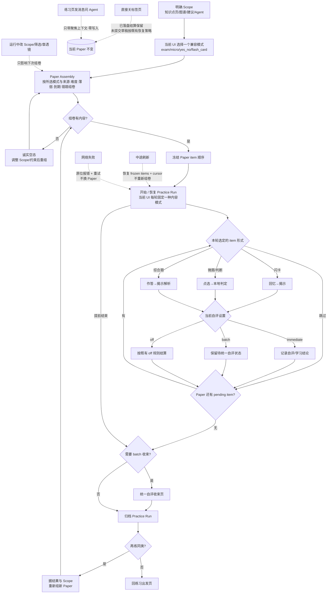
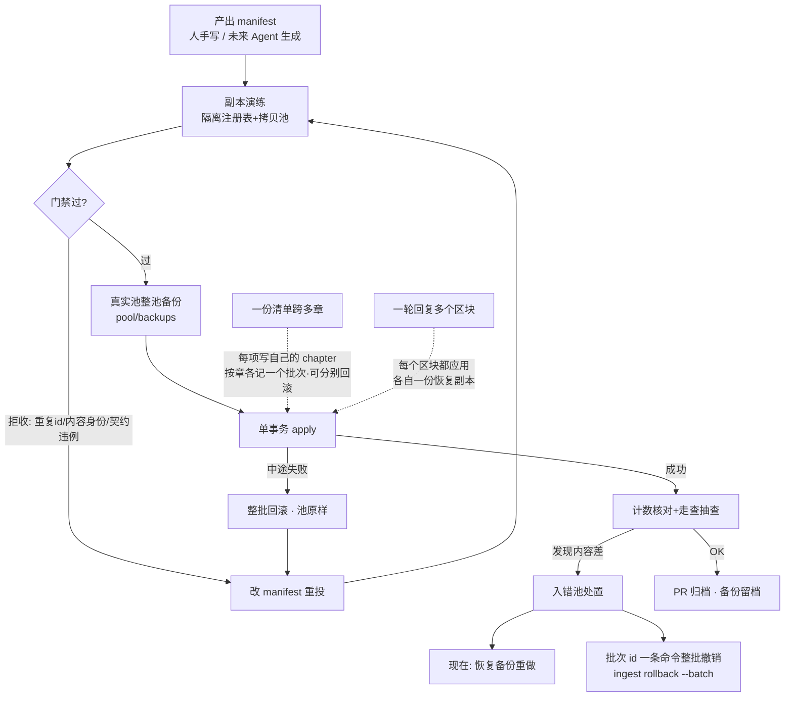
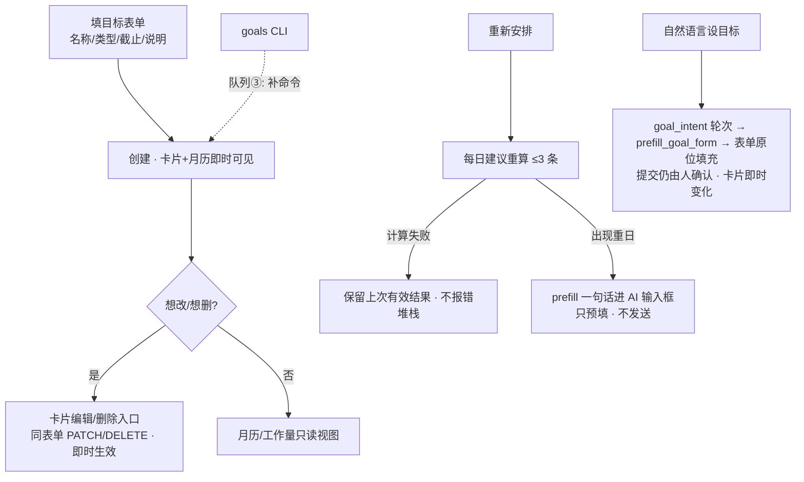
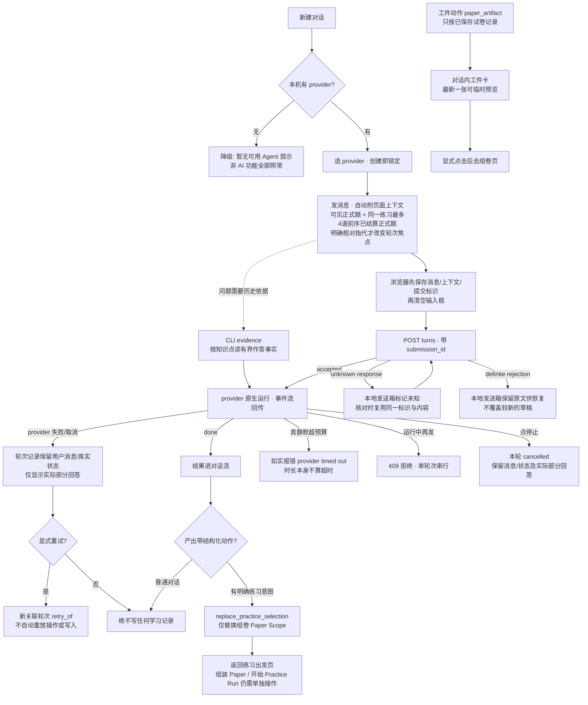
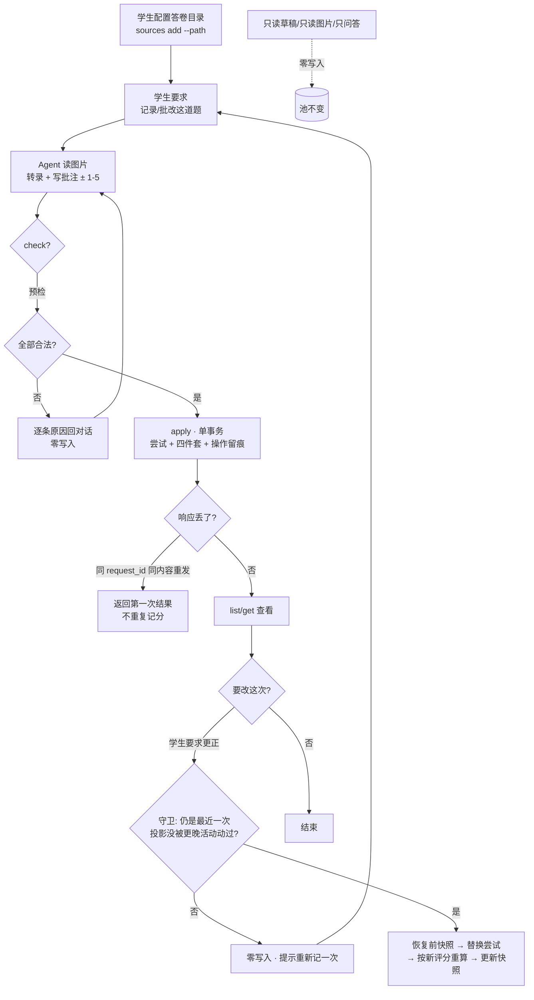
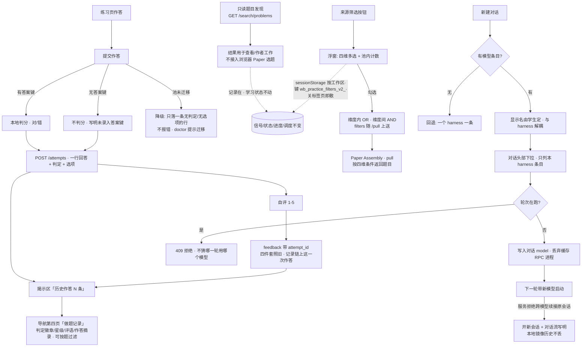
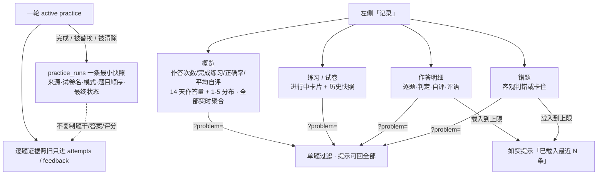
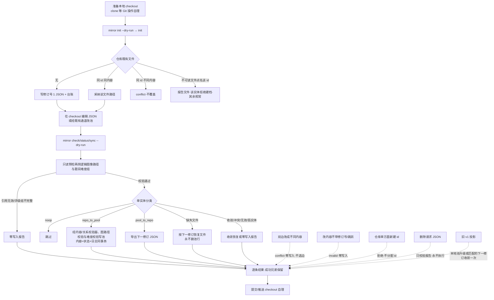
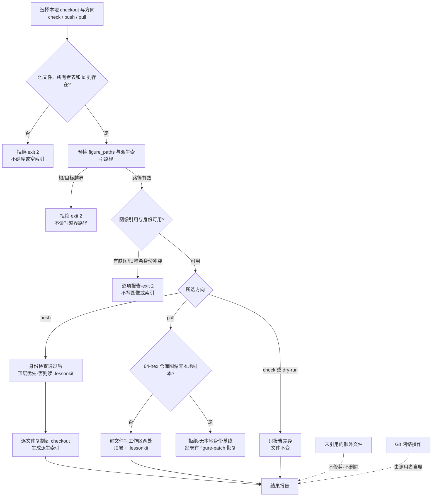

# L4 · 工作流层（用户真实路径 + 全部意外分支）

> 本层是 v2 的灵魂：**不许只画 happy path**。用户会回退、放弃、跳过、直接关闭——
> 每个出口都要有分支和落点。每条边可回溯 L3 动作；每个写库节点可回溯 L0。

## W1 · Paper → Practice Run 练习回路



核心不变量：**Scope 回答想练什么，Paper 回答这次具体做什么，Practice Run 只负责把这张 Paper 做完。**
任何建议、筛选、调度或对话都不得向运行中的 Paper 动态加题；“再练同类”永远组新 Paper。
刷新恢复 frozen items 与游标而不重新组卷；提前结束仍走既有 batch 收束规则；网络失败原位重试；
直接关闭只保留已经落盘的事实。跳过继续保持现有“不凭空写学习证据”的语义。

当前练习 UI 仍用单一兼容模式组装和启动每轮；混合格式 Paper 的 learner UI 尚未交付。

## W2 · 内容入库（唯一合法写池通道）



> 2026-09-25（in-place-problem-edits）：入库之后改题不再等于「删除重导」。原地补丁保留题号与全部学习记录，可把选项从题面拆进 `options` 让旧单选题变成小测题，整批存旧值可 `rollback` 还原；判断题/单选题的题干上限同时从 200 放宽到 800 字。批量修改只在学生明确要求时执行。
> 2026-09-26：题干上限取消（真题长篇客观题不再被退回综合题），摄入门禁与原地改题同步生效。

> 2026-09-25（ingest-mode-choice-and-contract-parity）：入库时可选题型——判断题（`quiz_type: yes_no`）
> 与单选题（`single_choice`/`multiple_choice` + 选项）即使**题源没有答案键**也能入库：这类题不判分，
> 练习页写明「本题未录入答案键」并由学生自评，答案键可事后用 `data update problem` 补；普通题目（不给
> `quiz_type`）进综合题，声明小测/判断模式却不给 `quiz_type` 会被拒收。学生一次说清的章要一轮导完，
> 前一章入完不再问「要不要继续」；章推不出来（该项与清单顶层都没有 `chapter`）时点名拒收，不再
> 静默按当前章落库。

> 2026-09-25（cross-chapter-content-bundles）：清单可跨章（每项声明自己的 `chapter`，缺省顶层→当前章），
> 发号/落图按该项的章，题目身份重复检查覆盖整个课程；按章各记一个批次，因此回滚可以只撤其中一章；一轮回复里的每个
> content-bundle 区块都会被依次应用（各自一份恢复副本），不再只应用第一个。

> 2026-09-29（content-dedup-and-audit）：先用 `lesson-kit data <workspace> audit` 读取题库卫生基线；新题按完整题干身份跨来源、跨章节拒重。apply 后已有内容被修改时，回滚先报告冲突，不创建回滚备份、不覆盖后续内容。

## W3 · 目标与计划（含缺口标记）



## W4 · Agent 对话与动作



工具结果卡展示归一化的动作与终态；只有后端证据支持时才说明已知影响，否则标为未知。诊断折叠并脱敏；没有对应后端操作时不提供单步重试。

> 2026-10-12（agent-context）：当前可解析正式题是页面锚点；只有它属于同一 active practice 时才附前序题。否定或同时比较当前/上一题的表达保留页面默认焦点，未知题号与闪卡号不形成正式题焦点；这条上下文读取不写学习记录或移动游标。

> 2026-09-25（bridge-timeouts-follow-progress）：原 `E -- 掉线/超时/退出 --> F1` 拆成两条——
> **时长本身不构成超时**，只有静默超预算才失败。预算按静默计：任一输出行或归一事件重置时钟，
> 命令/工具在飞时改用更长的工具预算（`bridge add --timeout` / `--tool-timeout`，`bridge list`
> 报生效值），因此 3 分钟以上的回答与长时间安静的构建都不会被截停，也不会再把正在运行的命令
> 一起杀掉；真卡住时仍如实报 `provider timed out`。

## W5 · Agent 代录手写作答（2026-09-24）



## W6 · 组一张 Paper、保存与打印

```mermaid
flowchart TD
  A[确定 Scope<br/>章透镜/--kp/显式知识点] --> B[加入组卷约束<br/>来源/难度/weak/due/wrong]
  B --> C[Paper Assembly · pull]
  X[Agent/CLI 需要精确某题] -.作者工具 --problem.-> C
  C --> D[固定顺序 + reason<br/>scope/weak/due/wrong/explicit]
  D --> E{下一步}
  E -- 直接开始 --> F[Practice Run<br/>执行固定 Paper]
  E -- --plan --> G[Paper manifest<br/>v1 kind: practice-set 兼容]
  G --> H{保存到工作台?}
  H -- 是 --> I[lesson-kit papers save] --> J[保存的 Paper]
  H -- 否 --> K{导出/检查?}
  J --> F
  K -- --check --> L[零写入预检]
  K -- --print --> M[学生卷 + 解答卷]
  Y[浏览器学生侧] -.不提供逐题搜索勾选/include_ids.-> C
```

`--problem` 只属于 Agent/CLI Paper authoring；学生控制 Scope 和策略，不逐题手选。产品级 Practice Set 是组织多张 Paper 的容器，不在本工作流直接执行。

## W7 · 做题记录、来源筛选与对话内换模型（2026-09-26）



> 2026-09-26（attempt-records-filters-and-model-entries）：三件事合并交付。**记录**：提交即落库
> （判定与选项同存），自评通过 `attempt_id` 链回那次作答，于是「作答了什么、判定如何、评为几分」
> 读得成一行；记录只增不改，学习状态仍只由自评驱动。**筛选**：来源维度在
> CLI、API 与练习页浮窗同一语义——维度内 OR、维度间 AND；文档键把两套证据书写格式折成一份文档
> 一个键，计数取自池内实际值。
>
> **历史状态（2026-10-16）**：下方 2026-10-06 描述中的浏览器关键词搜索结果勾选并注入 `include_ids` 路径，已随 PR130 退役；保留原记录说明当时的变更。四维来源筛选与 CLI 关键词筛选继续可用，题目搜索仅作只读发现/作者工作。
>
> 2026-10-06（problem-search-and-origin-filter）：来源维度由三个增为**四个**（多一个题目来源方式
> `origin_kinds`，浮窗显示历年原题/改编/AI生成，CLI 改可重复的 `--origin-kinds`，单值 `origin_kind`
> 删除不兼容）。浮窗的「一个搜索框」变成**两个关键词域**：题干域（标题/题面）与来源域
> （来源证据/考查年份/题面开头的 `【…】` 标签段，老池把卷面身份只写在那里），各域按空格切多词、
> 域内 AND，两域都填则跨域 AND；域的定义只有一份，搜索与 `/pull` 的 `--search-stem`/
> `--search-source` 共用。两框都空返回空集而不是全池。旧 `?q=` 参数删除，浮窗存储键升为
> `wb_practice_filters_v2_<ws>`。**模型**：bridges.json 的 `models` 条目让显示名与 harness 解耦
> （不再显示 `pi · deepseek/…`），对话记住自己的模型并可在头部下拉里换，**下一轮**生效。

> 2026-10-06/07（practice-set-item-preview）：组卷页先展示试卷卡片；卡片默认折叠，展开状态
> 按工作区记在当前标签页。卡片命令不切换折叠状态，命令失败的状态行仍在折叠区外；打开题目项
> 只呈现题面与来源，答案继续由导出解答卷提供。

## W8 · 记录中心（2026-09-29）



> 2026-09-29（records-center groundwork）：左侧「记录」从单列历史页扩为记录中心。快照只在
> 一轮结束时写一条，统计图永远实时从 attempts / feedback 聚合、不缓存统计值；旧池迁移增量补
> `practice_runs` 表与 `active_practice.source_label` 列，已有行零改动。错题视图按**值**判
> verdict（sqlite 返回 0/1，不是布尔），作答明细与错题在触到载入上限时如实说明截断。

## W9 · 作者内容镜像审阅与同步（2026-10-10，PR110；字段扩展 2026-10-13，PR123）



## W10 · 显式同步已引用插图（2026-10-12/13，PR113）



预检检查整个引用集合、工作区/checkout 根和索引路径；即使没有图像引用，索引也会独立检查。
每个文件单独原子替换；运行系统写入错误可能发生在前一文件已替换之后，不提供整轮回滚。

## 意外分支总清单（防"想当然"复查用）

| # | 意外 | 落点 |
|---|---|---|
| 1 | 中途刷新 | 牌组恢复（游标+视图态） |
| 2 | 直接关标签页 | 保存卷的文本/选择草稿与未完成进度保留；已评分在池安全 |
| 3 | 跳过单题 | 不写库不记欠账；已答/已玩不降级 |
| 4 | 跳过到底直接走 | 空态/收束页，不强迫评完 |
| 5 | 提前结束 | batch→收束页；immediate→回开始区 |
| 6 | batch 耗尽后再回练习页 | ended 标志自动重回收束页 |
| 7 | 拉空范围 | 诚实空态，不偷换内容 |
| 8 | 网络失败 | 原位报错+重试，不吞操作 |
| 9 | 门禁拒收 | 改 manifest 重投，池零污染 |
| 10 | apply 中途失败 | 单事务整批回滚 |
| 11 | 入错池 | `ingest rollback --batch <id>` 整批撤销 |
| 12 | provider 掉线/超时 | 如实报错，会话仍锁定 |
| 13 | 双发消息 | 409 串行 |
| 14 | 无 provider | 全功能降级可用 |
| 15 | 目标想改/删 | 卡片编辑/删除入口（complete-goals-loop） |
| 16 | 代录的响应丢了（重发同 request_id） | 返回第一次结果，不重复记分（W5） |
| 17 | 更正时已有更晚活动/更晚尝试 | 零写入拒绝，提示重新记一次（W5） |
| 18 | 组练习时新池没有学习证据（--weak/--due/--wrong 空集） | 诚实空集 + shortage，提示先用范围/条件筛选（W6） |
| 19 | 练习清单里有陌生或重复题目 | 非零退出、逐条点名，零写入（W6） |
| 20 | 拟打印的学生卷会泄漏内部标识/答案 | 预检拦下并点名，不写文件（W6） |
| 21 | 清单里某项推不出所属章（无 item 章、无顶层章、无章透镜） | 点名该项并整批零写入，其余项不会被静默丢掉 |
| 22 | 显式 id 与该项声明的章不一致 | 拒收并同时说出 id 属于哪一章（图不会再落错目录） |
| 23 | 一轮里第二个内容区块的恢复副本重名 | 每个动作各自一份恢复副本，两个区块都能落盘 |
| 24 | 提交作答时池尚未迁移（缺请求记录表） | 浏览器请求拒写并提示迁移命令；旧无请求 id 调用仍可列感知降级（W7） |
| 25 | 客观题没有答案键 | 不判分、写明「未录入答案键」，仍可作答与自评（W7） |
| 26 | 浮窗里某个维度在池内没有值 | 该维度显示「本池暂无此维度」，不回退成假选项（W7） |
| 27 | 对话轮次运行中切模型 | 409 拒绝，不猜哪一轮用哪个模型（W7） |
| 28 | 切模型后服务拒绝续接原会话 | 放弃该原生会话一次、开新会话并在对话流写明，本地镜像不丢（W7） |
| 29 | 条目挂的 harness 不在本机 | 该条目被跳过（不报错、不顶替），其余条目照常可用（W7） |
| 30 | 作答或自评已经落库但响应丢失 | 会话保存原请求 id 和载荷，重试取回首次结果，不再写一条（W7） |
| 31 | 错题视图拿到 sqlite 的 verdict=0（不是布尔 False） | 按值判定：0 计入错题，NULL 才是未判定（W8） |
| 32 | 池还没迁移就打开记录中心 | 只读聚合照常工作；练习轮次功能等 `practice_runs` 表出现后自动可用（W8） |
| 33 | 载入窗口外的更早记录 | 明细/错题页顶部提示「已载入最近 N 条」，不假装是全部（W8） |
| 34 | 仓库缺实体文件 | 不视为删除；池行保留，按新修订恢复文件（W9） |
| 35 | 仓库出现不可读 JSON | 报告文件；被其点名 id 的实体拒绝建档，其余实体照常（W9） |
| 36 | 池与仓库两边改成不同内容 | conflict 零写入，不静默选边（W9） |
| 37 | 仓库单方面新建 id | 拒绝，不分配 id、不写池（W9） |
| 38 | 图像根、目标或索引经 junction/symlink 越出工作区/checkout | 预检拒绝，exit 2，不读写越界路径（W10） |
| 39 | 旧 64-hex 图像存在不同字节副本 | 报 conflict，整轮图像/索引零写入（W10） |
| 40 | 旧 64-hex 图像仅存在于仓库且工作区无基线 | pull 拒绝，不创建工作区副本（W10） |
| 41 | 没有任何图像引用 | 仍独立检查索引；push 写入空派生索引（W10） |
| 42 | 池数据库缺失/不是普通文件，或缺所有者表/id 列 | exit 2；不建库、不生成空索引（W10） |
| 43 | Agent 消息已接收但响应丢失，或接收状态未知 | 本地发送箱保留原提交标识与内容；核对复用原请求，已接收轮次不重复启动（W4） |
| 44 | Agent 消息明确被拒绝或输入框已有较新草稿 | 拒绝消息可刷新后恢复；恢复动作不覆盖新草稿（W4） |
| 45 | Agent 在接收消息后失败/取消 | 历史保留原消息和终态；只显示真实存在的脱敏部分回答；显式重试新建关联轮次（W4） |
| 46 | 工具活动只报告 error 或未证明影响 | `error` 显示为终态失败，影响标未知；诊断折叠脱敏，不提供无支持的选择性重试（W4） |
